# FOTOMAC — como o sistema foi construído

**Guia de estudo pessoal para a apresentação · Thiago Nunes · outubro de 2026**

Este guia explica o FOTOMAC por dentro: o que já foi feito, o que falta, como as peças se
encaixam e por que cada decisão foi tomada. O objetivo é que você consiga explicar qualquer
parte do sistema com as suas próprias palavras. Cada capítulo começa pela ideia e só depois
mostra o código.

**Sumário**

1. O FOTOMAC em uma página
2. O que fizemos, e em que ordem
3. O que está pronto e o que falta
4. A arquitetura: as cinco peças
5. Como as peças se ligam
6. O reconhecimento facial por dentro
7. Os caminhos de ponta a ponta
8. O banco de dados
9. O trabalhador em segundo plano
10. Privacidade desde o desenho (LGPD)
11. Como provamos que funciona
12. Onde está cada coisa no código
13. Limitações que você deve conhecer
14. Perguntas que a banca pode fazer
15. Glossário

---

## 1. O FOTOMAC em uma página

**O problema.** O CESMAC fotografa formaturas, congressos e jogos. Depois do evento, a pessoa
que quer as próprias fotos teria de folhear centenas de imagens de desconhecidos, o que é lento
e expõe todo mundo que aparece nelas.

**A solução.** A pessoa abre a página do evento, tira uma selfie (ou envia uma foto) e o
sistema mostra **apenas as fotos em que ela aparece**. Ninguém vê a galeria inteira.

**Quem usa:**

| Perfil | O que faz | Precisa de conta? |
|:---|:---|:---|
| **Visitante** | Encontra as próprias fotos pelo rosto, baixa e pede remoção | Não |
| **Fotógrafo** | Cria eventos, envia, confere e publica as fotos | Sim, por convite |
| **Administrador** | Gerencia contas, temas e parâmetros do reconhecimento | Sim |

**A frase que resume o projeto:** o rosto é um dado pessoal **sensível**, de natureza
biométrica (LGPD, Art. 5º, II), então o sistema inteiro foi desenhado para usar o mínimo
possível desse dado, pelo menor tempo possível, e só depois que a pessoa declara estar ciente.

---

## 2. O que fizemos, e em que ordem

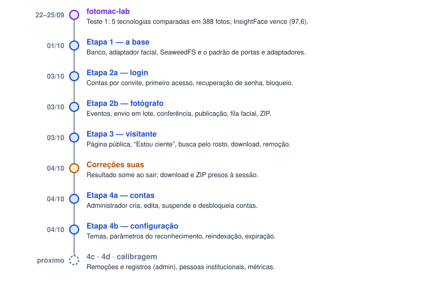

*Figura 1 — Linha do tempo do desenvolvimento.*

O trabalho começou **antes do sistema**, no **fotomac-lab**: uma bancada de testes em que
comparamos 5 tecnologias de reconhecimento facial com fotos reais de formatura. O InsightFace
venceu, e foi a partir dele que o sistema foi construído (detalhes no capítulo 6).

Depois, o sistema foi construído em **etapas**. Cada uma foi entregue funcionando e testada
antes da próxima começar:

| Etapa | O que entregou |
|:---|:---|
| **1 — A base** | Banco de dados, adaptador do reconhecimento facial, ligação com o SeaweedFS |
| **2a — Login** | Contas por convite, primeiro acesso, recuperação de senha, bloqueio após 5 erros |
| **2b — Fotógrafo** | Eventos, envio em lote, conferência, publicação, fila de indexação facial, ZIP |
| **3 — Visitante** | Página pública, “Estou ciente”, busca pelo rosto, download, remoção |
| **Correções** | Pontos que você reprovou nos testes: o resultado some ao sair; links presos à sessão |
| **4a — Contas** | O administrador cria, edita, suspende e desbloqueia contas |
| **4b — Configuração** | Temas, parâmetros do reconhecimento, reindexação, expiração automática |

O diário completo, com o porquê de cada decisão, está em `HISTORICO.md`.

---

## 3. O que está pronto e o que falta

O documento de requisitos (v1.6, seção 9) divide o sistema em **três fases de entrega**.
Comparando com o que existe hoje:

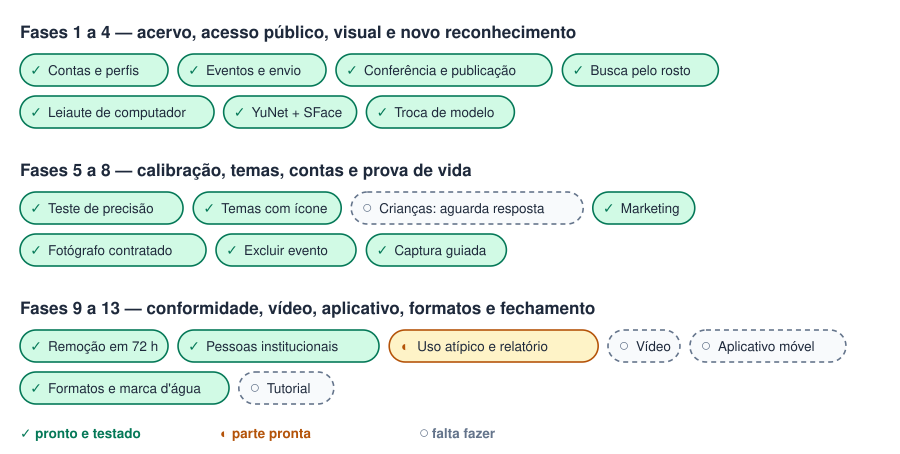

*Figura 2 — Situação de cada item das fases de entrega.*

**O que falta, em detalhe:**

| Item | Requisito | O que já existe | O que falta |
|:---|:---|:---|:---|
| Remoção em 72 h | RF023 | O pedido do visitante, a exclusão automática e os e-mails | A tela do administrador que lista os pedidos |
| Registros e uso atípico | RF024 | O registro inalterável (`audit_log`) grava tudo | A tela de consulta e o alerta de uso atípico |
| Pessoas institucionais | RF020, RF021 | — | Tudo: cadastro e consulta |
| Calibragem do limiar | RNF18 | O Teste 1 do fotomac-lab | Medir precisão e revocação com mais pessoas |
| Exportação | RNF14 | Os registros já existem no banco | Exportar registros de operações, consultas institucionais e ciências, para provar a conformidade |

**Fora das fases:** o aplicativo móvel, a implantação no servidor do CESMAC e as métricas da
seção 10 dos requisitos (tempo de busca, taxa de indexação etc.).

> **Para a banca:** as Fases 1 e 2 estão completas. A evolução até a próxima banca é o que
> está nesta tabela, e a calibragem do limiar é a parte mais “científica” dela.

---

## 4. A arquitetura: as cinco peças

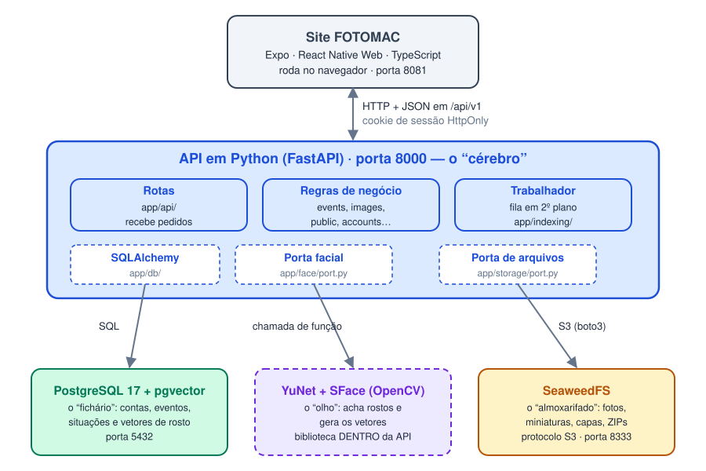

*Figura 3 — As cinco peças do sistema e como conversam.*

Pense no sistema como um **estúdio fotográfico**:

| Peça | Papel no estúdio | O que é de verdade |
|:---|:---|:---|
| **Site (Expo)** | A **vitrine/balcão**: onde as pessoas são atendidas | Telas que rodam no navegador |
| **API Python** | O **gerente**: recebe todo pedido, confere quem pediu e decide | Um programa servidor que responde em JSON |
| **PostgreSQL** | O **fichário**: as fichas de cada evento, foto e conta | Banco de dados relacional |
| **SeaweedFS** | O **almoxarifado**: guarda as caixas (arquivos de foto) | Armazenamento de objetos, protocolo S3 |
| **InsightFace** | O **olho**: reconhece rostos | Biblioteca de IA, usada dentro da API |

**Três regras de ouro da arquitetura:**

1. **O site nunca fala com o banco nem com o SeaweedFS.** Ele só fala com a API. É a API que
   confere a permissão antes de qualquer coisa, assim como o balconista não entra no
   almoxarifado: ele pede ao gerente.
2. **O almoxarifado não sabe o que guarda.** O SeaweedFS só conhece “caixa com tal etiqueta”.
   Quem sabe que a caixa `events/…/abc.jpg` é a foto 37 da formatura é o fichário (PostgreSQL).
3. **O InsightFace não é um servidor.** Ele é uma biblioteca carregada **dentro** do processo
   da API, e a API chama uma função dele como chamaria qualquer outra função Python. Por isso
   ele aparece tracejado na figura.

**As portas na sua máquina:**

| Serviço | Endereço | Quem acessa |
|:---|:---|:---|
| Site | `localhost:8081` | Você, pelo navegador |
| API | `localhost:8000` | O site |
| PostgreSQL | `127.0.0.1:5432` | Só a API |
| SeaweedFS | `127.0.0.1:8333` | Só a API |

---

## 5. Como as peças se ligam

Esta é a pergunta mais importante: *como o Python fala com o SeaweedFS, com o Expo e com o
modelo?* Cada ligação usa um **protocolo**, que é um idioma combinado entre dois programas.

### 5.1 Site (Expo) ↔ API (Python): HTTP e JSON

O site e a API são **dois programas separados**, que podem até estar em computadores
diferentes. Eles conversam pela internet, em **HTTP**, trocando mensagens em **JSON** (texto
estruturado).

Todo pedido do site passa por **uma única função**, em `frontend/src/api/client.ts`:

```ts
// A ÚNICA porta das telas para o servidor
const response = await fetch(`${API_URL}/api/v1${path}`, {
  credentials: 'include',     // envia o cookie da sessão
  ...
});
```

Do lado do Python, o **FastAPI** recebe o pedido e escolhe a função pelo endereço:

```python
@router.post("/events/{event_id}/search")   # backend/app/api/public.py
def search(...):
    ...
```

- **`/api/v1`:** o “v1” é a versão do contrato. Quando o aplicativo móvel chegar, ele vai usar
  **exatamente a mesma API**, sem duplicar regra nenhuma.
- **Cookie HttpOnly:** depois do login, a API entrega um cookie que o JavaScript **não
  consegue ler**. Assim, mesmo que um script malicioso rode na página, ele não rouba a sessão.
- **CORS:** a API só aceita pedidos com cookie vindos do endereço do site
  (`localhost:8081`). Outro site não consegue usar a sessão de quem está logado.

### 5.2 API ↔ PostgreSQL: SQL, pelo SQLAlchemy

O Python não escreve SQL “na mão” na maior parte do código. Ele usa o **SQLAlchemy**, que
traduz classes Python em tabelas:

```python
class Image(Base):            # backend/app/db/models.py
    __tablename__ = "images"
    ...
```

A estrutura do banco evolui por **migrações** (`backend/migrations/`, ferramenta **Alembic**).
Cada migração é um passo numerado (0001 a 0007), e qualquer computador chega ao mesmo banco
rodando `alembic upgrade head`. O **pgvector** é uma extensão do PostgreSQL que cria o tipo
`vector` e sabe comparar vetores rapidamente (capítulo 6).

### 5.3 API ↔ SeaweedFS: o protocolo S3, pelo boto3

**S3** é o idioma criado pela Amazon para guardar arquivos (“objetos”) em “baldes”
(*buckets*). Ele virou padrão de mercado, e o SeaweedFS **fala S3**. Por isso usamos o
**boto3**, a biblioteca oficial de S3 para Python. Ela não sabe que do outro lado está o
SeaweedFS, e nem precisa saber.

```python
# backend/app/storage/s3_storage.py
self._client = boto3.client("s3", endpoint_url=endpoint,
                            aws_access_key_id=access_key,
                            aws_secret_access_key=secret_key)
```

Os endereços e as senhas ficam no arquivo `backend/.env`, que **nunca** vai para o GitHub:

```
FOTOMAC_S3_ENDPOINT=http://127.0.0.1:8333
FOTOMAC_S3_BUCKET=fotomac-acervo
```

**Como as fotos ficam organizadas no almoxarifado.** Cada foto enviada vira três arquivos:

```
events/<id do evento>/<id da foto>.jpg          ← original (com crédito, sem GPS)
events/<id do evento>/<id da foto>_thumb.jpg    ← miniatura de 480 px
events/<id do evento>/<id da foto>_preview.jpg  ← prévia de 1600 px
```

Os ids são **aleatórios** (UUID), e não 1, 2, 3, para que ninguém consiga adivinhar o endereço
da próxima foto.

**Por que não guardar as fotos no próprio PostgreSQL?** Bancos relacionais são ótimos para
fichas pequenas, mas lentos e caros para milhares de arquivos de 10 MB. Além disso, o
SeaweedFS **já é o que o servidor do CESMAC usa**.

### 5.4 API ↔ InsightFace: o adaptador

Aqui está o pedido do seu orientador: **o sistema não pode depender da biblioteca de IA**.
A solução é o padrão **portas e adaptadores**:

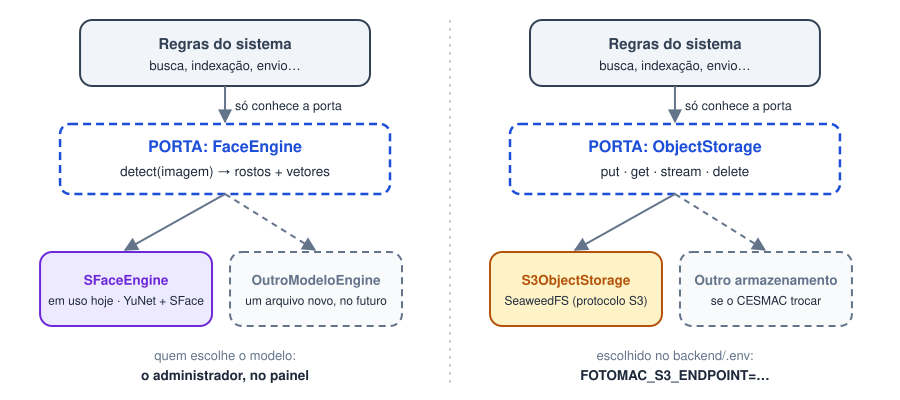

*Figura 4 — Portas e adaptadores: o mesmo desenho para o rosto e para os arquivos.*

Pense numa **tomada**:

- A **porta** é a tomada da parede. Ela define o formato: “me dê uma imagem e eu devolvo os
  rostos com os vetores” (`backend/app/face/port.py`). Esse arquivo **não importa nenhuma
  biblioteca de IA**.
- O **adaptador** é o plugue do aparelho. Hoje há um, `insightface_engine.py`, o **único
  arquivo do sistema inteiro** que faz `import insightface`.
- A **fábrica** (`factory.py`) lê o `.env` e conecta o plugue certo:
  `FOTOMAC_FACE_ENGINE=insightface`.

**Para trocar de IA:** escreve-se um arquivo novo de adaptador e muda-se uma linha do `.env`.
Busca, indexação e telas não mudam. Como vetores de modelos diferentes **não são comparáveis
entre si**, cada vetor guarda a versão do modelo que o gerou, e a **reindexação** (tela do
administrador) gera os vetores novos para o acervo inteiro.

O **mesmo desenho** vale para os arquivos: se o CESMAC um dia trocar o SeaweedFS, só o
adaptador de armazenamento muda.

---

## 6. O reconhecimento facial por dentro

### 6.1 Qual modelo usamos

**InsightFace 1.0.1** com o pacote de modelos **buffalo_l**. O pacote traz vários modelos; o
FOTOMAC carrega **apenas dois**:

| Modelo | Arquivo | Função |
|:---|:---|:---|
| **SCRFD** (detector) | `det_10g.onnx` (17 MB) | Encontrar onde estão os rostos na foto |
| **ArcFace ResNet-50** (reconhecedor) | `w600k_r50.onnx` (174 MB) | Transformar cada rosto em 512 números |

O pacote também traz modelos de **idade, gênero e pontos 3D do rosto**, e eles ficam
**desligados de propósito** (`allowed_modules=["detection", "recognition"]`). O sistema não
precisa desses dados, e calcular dado pessoal sem finalidade fere o princípio da
**necessidade** (LGPD, Art. 6º, III: “limitação do tratamento ao mínimo necessário”).

Os modelos rodam pelo **ONNX Runtime**, na **CPU**: não é preciso placa de vídeo.

### 6.2 Do rosto ao vetor, passo a passo

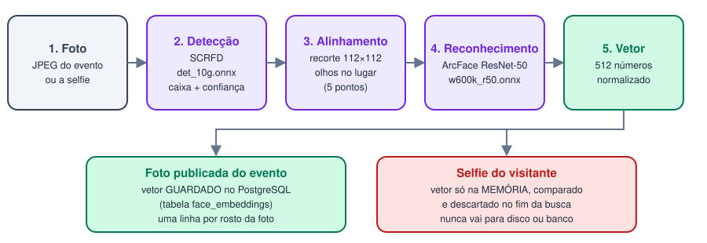

*Figura 5 — O caminho de uma foto até o vetor, e o destino diferente para foto e selfie.*

1. **Foto:** o JPEG é decodificado na memória.
2. **Detecção (SCRFD):** o modelo devolve uma **caixa** em volta de cada rosto e uma
   **confiança** de 0 a 1. Rostos com confiança abaixo de 0,50 são ignorados.
3. **Alinhamento:** usando 5 pontos (olhos, nariz e cantos da boca), o rosto é recortado em
   112×112 pixels com os olhos sempre na mesma posição, para o reconhecedor comparar sempre
   “na mesma pose”.
4. **Reconhecimento (ArcFace):** a rede neural transforma o recorte em **512 números**. Esse
   é o **vetor facial**, ou *embedding*: uma espécie de “impressão digital” matemática do rosto.
5. **Normalização:** o vetor é ajustado para ter comprimento 1, o que torna a comparação mais
   simples (próxima seção).

**Uma diferença crucial:** o vetor de uma **foto publicada** é guardado no PostgreSQL. O vetor
da **selfie** fica só na memória: é comparado e descartado no fim da busca, e nunca vai para
disco, banco ou log.

### 6.3 Como comparar dois rostos: similaridade de cosseno

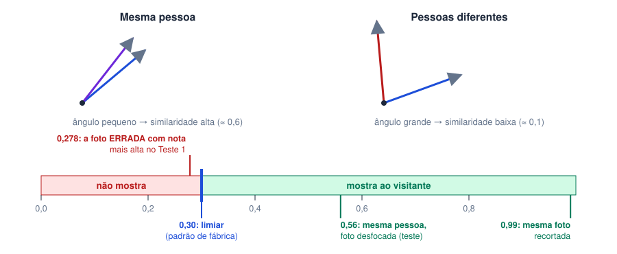

*Figura 6 — A intuição das setas e a régua do limiar.*

Imagine cada vetor como uma **seta** num espaço de 512 dimensões. Rostos da **mesma pessoa**
geram setas que apontam **quase para o mesmo lado**; pessoas diferentes geram setas em
direções diferentes. A **similaridade de cosseno** mede o quanto duas setas apontam para o
mesmo lado: perto de 1, parecidíssimas; perto de 0, nada a ver.

O **limiar** é a nota de corte. No FOTOMAC ele vem de fábrica em **0,30**:

- No Teste 1, a foto **errada** com a nota mais alta tirou **0,278**. Com corte em 0,30,
  nenhuma foto de outra pessoa apareceu.
- O sistema prefere **precisão** a **revocação**: é melhor deixar de mostrar uma foto sua do
  que mostrar a foto de outra pessoa para você. Mostrar a foto errada expõe um terceiro.
- Mexer no limiar muda tudo, por isso o administrador só altera depois de ler uma advertência
  de falso positivo, e a mudança fica registrada.

### 6.4 Qual rosto da selfie é usado

Se a selfie tiver mais de uma pessoa, o sistema usa **um único rosto**, escolhido sempre do
mesmo jeito (RF017):

1. Descarta rostos de baixa qualidade (confiança abaixo do mínimo, ou lado menor que 40 pixels).
2. Escolhe o rosto de **maior área**: quem está mais perto da câmera.
3. Em caso de empate: maior confiança, depois o mais perto do centro.

Assim, uma selfie em grupo **nunca** devolve as fotos de todo mundo do grupo.

### 6.5 Como a busca fica rápida: o índice HNSW

Comparar a selfie com milhares de vetores, um por um, seria lento. O pgvector usa um índice
**HNSW**, uma espécie de “mapa de atalhos” entre vetores parecidos, que encontra os mais
próximos sem olhar todos. A busca é sempre **filtrada por evento**: o sistema nunca compara a
selfie com o acervo inteiro.

### 6.6 Por que o InsightFace: o Teste 1

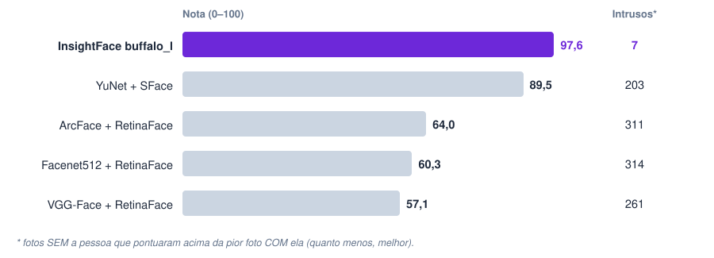

*Figura 7 — Resultado do Teste 1 (fotomac-lab, 388 fotos de formatura conferidas à mão).*

| O que foi medido | Como |
|:---|:---|
| Conjunto | 388 fotos reais de formatura, com plateia, perfis e rostos ao fundo |
| Pessoa procurada | O coordenador do curso, que aparece em dezenas de fotos |
| Gabarito | Cada foto conferida **à mão**: “está”, “não está” ou “está, mas o rosto que casou é de outro” |
| Nota | 100 × o melhor F1 (equilíbrio entre precisão e revocação) |

O InsightFace venceu com **97,6** e só **7 intrusos** (fotos sem o coordenador que pontuaram
acima da pior foto com ele), contra 203 do segundo colocado.

**Um achado que vale citar:** o resultado **contraria as tabelas publicadas**, em que o
Facenet512 aparece entre os melhores. Aquelas tabelas medem pares de rostos já recortados; a
nossa tarefa é achar uma pessoa numa plateia. Conclusão: **escolher tecnologia por tabela
publicada é arriscado**; é preciso medir na tarefa real.

---

## 7. Os caminhos de ponta a ponta

### 7.1 A vida de um evento e de uma foto

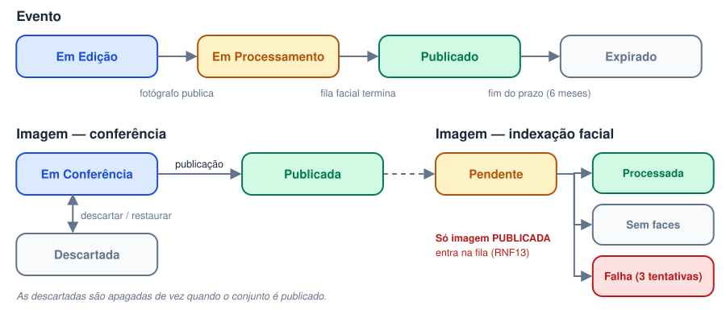

*Figura 8 — Os estados do evento e da imagem.*

1. O fotógrafo **cria o evento** (Em Edição) e **envia as fotos**. Em cada envio, o servidor:
   confere se é JPEG de verdade, recusa duplicatas, **remove o GPS**, grava o crédito do
   fotógrafo nos metadados e cria a miniatura e a prévia.
2. Na **conferência**, ele descarta o que não presta. Nada foi analisado pela IA ainda.
3. Ao **publicar**, as descartadas são apagadas de vez, e as publicadas entram na **fila de
   indexação**. O evento fica Em Processamento.
4. O **trabalhador** (capítulo 9) gera os vetores, foto por foto. Quando a fila do evento
   esvazia, o evento vira **Publicado** e aparece para o público.
5. No fim do prazo de retenção (6 meses depois do evento, ajustável), o evento **expira**:
   fotos, cópias, capa, pacotes e vetores são eliminados. O responsável recebe um aviso por
   e-mail 30 dias antes.

**Regra que vale ouro na banca:** *nenhum vetor facial existe antes da publicação.* O
fotógrafo pode desistir de qualquer foto na conferência sem que o rosto de ninguém tenha
virado dado biométrico.

### 7.2 A busca do visitante

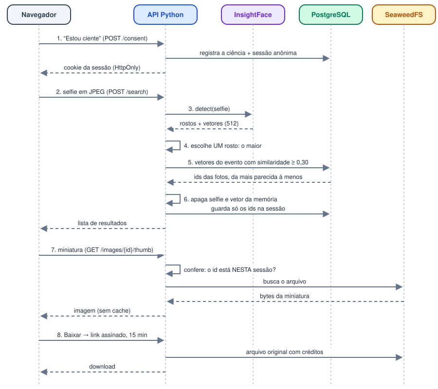

*Figura 9 — O que acontece, passo a passo, quando o visitante procura as próprias fotos.*

Os pontos que mostram o cuidado com a privacidade:

- **Passo 1:** sem o “Estou ciente”, **nenhum vetor é gerado**. A ciência fica registrada
  **sem nome e sem e-mail**. O visitante não tem conta: a sessão é anônima, num cookie.
- **Passo 6:** a selfie e o vetor dela são **apagados da memória** ao fim da função. A sessão
  guarda **só a lista de ids** das fotos encontradas.
- **Passo 7:** cada miniatura só é entregue se o id **está no resultado desta sessão**. Quem
  tentar adivinhar o endereço de outra foto recebe “não encontrada”.
- **Passo 8:** o download é feito por um **link assinado** (HMAC), válido por 15 minutos e
  preso à sessão: copiado para outra pessoa, ele não funciona. O arquivo sai pela API, e o
  endereço do SeaweedFS nunca chega ao navegador.
- **Ao sair da página**, o resultado é apagado. Pense num computador da biblioteca: a próxima
  pessoa não pode ver as suas fotos.
- **Limites:** 10 buscas por sessão, além de limites por endereço, contra quem tentar varrer
  o acervo com um robô.

### 7.3 Remoção a pedido do titular

O visitante pode pedir a remoção de uma foto (pela foto ampliada, ou enviando o arquivo
baixado). A foto **sai da busca na hora**, o fotógrafo e os administradores recebem e-mail, e,
se ninguém agir, o **sistema exclui sozinho em 72 horas**. Ao concluir, o e-mail de contato do
visitante também é apagado.

---

## 8. O banco de dados

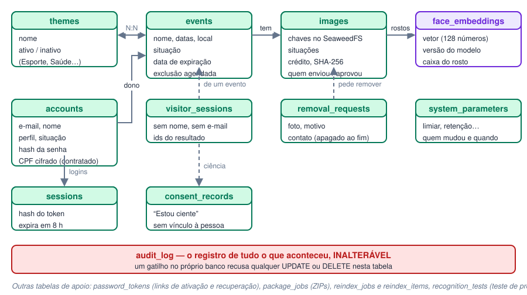

*Figura 10 — As principais tabelas e como se relacionam (simplificado).*

**As tabelas do fichário:**

| Grupo | Tabelas | Observação |
|:---|:---|:---|
| Equipe | `accounts`, `sessions`, `password_tokens` | A senha é guardada só como **hash Argon2id**; da sessão, só o hash do token |
| Acervo | `events`, `themes`, `images` | A foto em si está no SeaweedFS; aqui ficam as chaves e as situações |
| Biometria | `face_embeddings` | **Tabela separada** para o dado sensível, com a versão do modelo em cada linha |
| Visitante | `consent_records`, `visitor_sessions`, `removal_requests` | Sem nome, sem conta; o contato da remoção é apagado ao concluir |
| Operação | `system_parameters`, `package_jobs`, `reindex_jobs`, `reindex_items` | Parâmetros, ZIPs e reindexações |
| Prova | `audit_log` | **Inalterável**: um gatilho do banco recusa alterar ou apagar |

**Por que o `audit_log` é inalterável no próprio banco, e não só no código Python?** Se a regra
estivesse só no Python, qualquer pessoa com acesso ao banco poderia apagar um registro
incômodo. Com o gatilho, nem o sistema consegue. É isso que torna o registro uma **prova**
(LGPD, Art. 6º, X: responsabilização e prestação de contas).

---

## 9. O trabalhador em segundo plano

Gerar vetores leva tempo: cada foto custa uma fração de segundo, e um evento pode ter até
1.000 fotos. Se a API fizesse isso enquanto o fotógrafo espera, a tela travaria. Por isso existe o **trabalhador**: um laço que
roda **dentro da API**, numa linha de execução separada (*thread*), e processa as tarefas na
ordem.

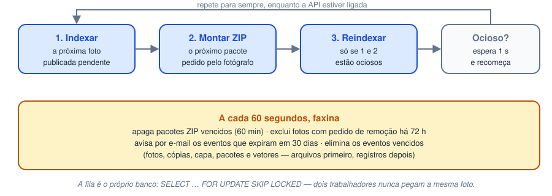

*Figura 11 — O laço do trabalhador e a faxina periódica.*

- **A fila é o próprio banco.** Uma foto “pendente” é uma linha com `indexing_status =
  'pending'`. Não há programa de fila extra para instalar.
- **`FOR UPDATE SKIP LOCKED`** é o truque que permite ligar vários trabalhadores ao mesmo
  tempo: cada um “tranca” a foto que pegou, e os outros pulam as trancadas. O mesmo código que
  roda no seu notebook escala para vários servidores.
- **Uma foto com defeito nunca para a fila:** são até 3 tentativas, com intervalo crescente, e
  depois a foto fica marcada como “Falha”.
- **Prioridade:** a reindexação só anda quando não há publicação esperando. O fotógrafo nunca
  espera por uma tarefa de manutenção.
- **Eliminação consistente:** ao apagar uma foto, os **arquivos são apagados primeiro** e a
  linha do banco **depois**. Na ordem inversa, uma falha no meio deixaria uma foto “órfã” no
  almoxarifado, sem ficha, que ninguém mais acharia para apagar.

---

## 10. Privacidade desde o desenho (LGPD)

A LGPD não foi uma revisão no final: ela decidiu a arquitetura. As regras que viraram código:

| Princípio / artigo (lido na lei) | Como virou código |
|:---|:---|
| **Dado sensível** (Art. 5º, II: “dado … biométrico, quando vinculado a uma pessoa natural”) | Vetor em tabela própria; nunca em log; selfie nunca armazenada |
| **Consentimento específico e destacado** (Art. 11, I) | “Estou ciente” **antes** da câmera, sem caixa pré-marcada, conferido no servidor |
| **Finalidade** (Art. 6º, I) | A busca serve a um evento; não existe busca no acervo inteiro |
| **Necessidade** (Art. 6º, III) | Idade e gênero desligados; GPS removido; visitante sem conta |
| **Término e eliminação** (Art. 15 e 16) | Expiração automática com eliminação de fotos, pacotes e vetores |
| **Segurança** (Art. 46) | Permissão conferida no servidor; sessão em cookie HttpOnly; senha em Argon2id; SeaweedFS privado |
| **Prestação de contas** (Art. 6º, X) | Registro de auditoria inalterável |

> **Limite honesto:** isto é engenharia com a lei na mão, não parecer jurídico. A base legal
> final, a Política de Privacidade e a indicação do encarregado (DPO) são decisões da área
> jurídica do CESMAC, e isso deve ser dito na banca.

---

## 11. Como provamos que funciona

| Tipo de teste | Quantos | O que prova | Comando |
|:---|:---|:---|:---|
| **Testes do servidor** (pytest) | 125 | Cada regra de negócio e de privacidade | `cd backend && .venv/bin/pytest` |
| **Testes de ponta a ponta** (Playwright) | 6 roteiros | Um navegador de verdade clica nas telas, com o InsightFace real | `node e2e/visitor.e2e.mjs …` |
| **Verificação de tipos** (TypeScript) | — | O site não tem erro de tipo | `npm run typecheck` |

Alguns testes que valem citar, porque provam a **regra** e não só o funcionamento:

- **Sem ciência, sem busca:** o servidor recusa a busca sem o “Estou ciente”, mesmo que alguém
  pule a tela.
- **Foto não publicada não entra na fila.**
- **Outra sessão não abre a foto:** o link de download de uma sessão dá erro em outra.
- **O limiar funciona de verdade:** uma foto desfocada da mesma pessoa (similaridade 0,56)
  aparece com limiar 0,30 e **some** com 0,60.

**Teste de mutação:** em alguns pontos, eu **estraguei o código de propósito** para ver se o
teste reclamava. Se o teste continua passando com o código errado, ele não protege nada. É a
forma de provar que o teste é bom.

**Os testes do servidor nunca tocam os seus dados:** usam um banco separado, o `fotomac_test`.
Os de ponta a ponta usam o banco de desenvolvimento, e por isso o script `cleanup_e2e.py` apaga
tudo o que eles criaram.

---

## 12. Onde está cada coisa no código

```
FOTOMAC (prototype)/
├── backend/                     a API em Python
│   ├── app/
│   │   ├── main.py              liga tudo: rotas, banco, modelo
│   │   ├── config.py            lê o .env (endereços, senhas)
│   │   ├── api/                 as rotas (endereços da API)
│   │   ├── face/                PORTA + ADAPTADOR do rosto
│   │   │   ├── port.py          a “tomada” (contrato)
│   │   │   ├── insightface_engine.py   o “plugue”
│   │   │   ├── factory.py       escolhe o plugue pelo .env
│   │   │   └── selection.py     qual rosto da selfie usar
│   │   ├── storage/             PORTA + ADAPTADOR dos arquivos
│   │   ├── indexing/            o trabalhador e a reindexação
│   │   ├── public/              regras do visitante
│   │   ├── events/ images/ …    regras do painel
│   │   ├── security/            links assinados (HMAC)
│   │   ├── parameters.py        parâmetros (RF026)
│   │   └── db/models.py         as tabelas
│   ├── migrations/              0001 … 0007: história do banco
│   ├── tests/                   os 125 testes
│   └── scripts/                 1º administrador, limpeza
├── frontend/                    o site em Expo
│   ├── src/app/                 as telas (arquivo = endereço)
│   │   ├── index.tsx            início público do visitante
│   │   ├── evento/[id].tsx      página do evento + busca
│   │   ├── login.tsx            entrada da equipe
│   │   └── (painel)/            fotógrafo e administrador
│   ├── src/api/client.ts        a única porta para a API
│   ├── src/components/          peças de tela
│   └── e2e/                     os testes de navegador
├── infra/                       liga PostgreSQL e SeaweedFS
└── docs/                        relatórios (este guia etc.)
```

**Três arquivos para ler com calma antes da banca:**

1. `backend/app/face/port.py`, para explicar o adaptador.
2. `backend/app/public/service.py`, função `search`, para explicar a busca com todas as
   proteções.
3. `backend/app/indexing/worker.py`, para explicar a fila.

---

## 13. Limitações que você deve conhecer

Reconhecer os limites na banca passa confiança. Os do sistema hoje:

1. **O Teste 1 mediu uma pessoa só.** A ordem do ranking é confiável; os números exatos, menos.
   A calibragem com mais pessoas (RNF18) é trabalho futuro.
2. **Licença do modelo:** os modelos do buffalo_l são liberados só para **pesquisa não
   comercial**. O TCC está coberto; uma implantação institucional precisa licenciar o modelo ou
   trocá-lo, e o adaptador existe também para isso.
3. **E-mails de desenvolvimento:** nenhum e-mail é enviado de verdade; cada mensagem vira um
   arquivo na pasta `backend/outbox/`. Em produção, basta um adaptador de e-mail real.
4. **Tudo roda numa máquina só, sem HTTPS.** No servidor do CESMAC, o cookie passa a exigir
   HTTPS (`cookie_secure=True`) e os endereços mudam só no `.env`.
5. **Os limites de requisição ficam na memória da API:** ao reiniciar a API, a contagem zera.
   Com vários servidores, seria preciso guardá-los num lugar comum.
6. **O trabalhador roda dentro da API.** Basta para o protótipo; em produção, ele pode rodar
   como um processo separado com `python -m app.indexing.worker`.

---

## 14. Perguntas que a banca pode fazer

**“Por que não guardar a selfie?”**
Porque não há finalidade para guardá-la. Ela só serve para gerar um vetor e comparar. Guardar
seria tratar dado biométrico além do necessário (Art. 6º, III), e um rosto vazado não se troca
como uma senha.

**“E se surgir um modelo melhor que o InsightFace?”**
Escreve-se um adaptador novo e muda-se uma linha de configuração. Depois, o administrador
manda reindexar o acervo; os vetores novos são criados antes de os antigos serem apagados, e a
busca nunca fica fora do ar.

**“Como você garante que um visitante não vê a foto de outro?”**
Três camadas: a busca é por um único evento; a sessão só guarda os ids encontrados para aquele
rosto; e toda imagem é entregue pela API, que confere se o id está naquela sessão. O endereço
do armazenamento nunca chega ao navegador.

**“Qual é a precisão do sistema?”**
No Teste 1, com 388 fotos conferidas à mão, o InsightFace alcançou F1 de 97,6% para a pessoa
testada, com AUC de 0,9995. A ressalva honesta: foi uma pessoa só, e a calibragem com mais
pessoas é a próxima etapa.

**“Por que um limiar de 0,30?”**
Porque, no Teste 1, a foto errada com a nota mais alta tirou 0,278. O sistema prefere não
mostrar a mostrar errado, e o administrador pode ajustar o valor depois de ler uma advertência.

**“Por que Python no servidor e não JavaScript?”**
As bibliotecas de reconhecimento facial (InsightFace, ONNX Runtime) são nativas de Python.
Colocar a IA no mesmo processo da API evita uma comunicação extra entre programas.

**“Por que web antes do mobile?”**
A API já é o contrato único (`/api/v1`): o aplicativo móvel vai consumir as mesmas rotas, e o
Expo permite reaproveitar boa parte das telas. Começar pela web entrega primeiro o fluxo
completo.

**“E se o servidor cair no meio da indexação?”**
A fila está no banco. Ao religar, o trabalhador continua de onde parou: a foto que estava
sendo processada continua como “pendente”, porque a transação não foi confirmada.

**“O sistema reconhece menores de idade?”**
O sistema **não estima idade** (o modelo de idade está desligado). O fotógrafo recebe uma
advertência no envio e pode substituir a foto por uma versão com o rosto borrado antes de
publicar.

---

## 15. Glossário

**Sistema e infraestrutura**

| Termo | Em uma frase |
|:---|:---|
| **API** | O programa que recebe pedidos e devolve respostas; aqui, o “gerente” do sistema |
| **HTTP / JSON** | O idioma (HTTP) e o formato das mensagens (JSON) entre o site e a API |
| **Endpoint / rota** | Um endereço da API, como `POST /api/v1/events/{id}/search` |
| **Cookie HttpOnly** | Um crachá guardado pelo navegador que o JavaScript não consegue ler |
| **ORM (SQLAlchemy)** | Ferramenta que transforma tabelas do banco em classes Python |
| **Migração** | Um passo numerado na evolução da estrutura do banco |
| **S3 / bucket / objeto** | O protocolo de armazenamento de arquivos; o “balde”; o arquivo |
| **Porta e adaptador** | A tomada (contrato) e o plugue (implementação), para trocar peças sem quebrar o resto |

**Reconhecimento facial, segurança e testes**

| Termo | Em uma frase |
|:---|:---|
| **Detecção** | Achar onde estão os rostos numa imagem |
| **Reconhecimento** | Transformar um rosto num vetor que permite comparar pessoas |
| **Vetor / embedding** | A lista de 512 números que representa um rosto |
| **Similaridade de cosseno** | O quanto dois vetores apontam para o mesmo lado (de 0 a 1, na prática) |
| **Limiar** | A nota de corte da similaridade para mostrar uma foto |
| **Precisão / revocação / F1** | Acertei o que mostrei? / Achei tudo o que existia? / O equilíbrio das duas |
| **Falso positivo** | Mostrar uma foto em que a pessoa **não** está, o erro mais grave aqui |
| **HNSW** | O índice de “atalhos” que acelera a busca de vetores parecidos |
| **Fila / trabalhador** | A lista de tarefas pendentes e o laço que as executa em segundo plano |
| **Transação** | Um grupo de alterações no banco que vale inteiro ou não vale nada |
| **HMAC / link assinado** | Uma assinatura que só o servidor sabe gerar e que prova que o link é legítimo |
| **Hash (Argon2id)** | Uma transformação sem volta; guarda a senha sem que ninguém possa lê-la |
| **Teste de ponta a ponta (e2e)** | Um robô usa o site num navegador real, como uma pessoa usaria |
| **Teste de mutação** | Estragar o código de propósito para provar que o teste percebe |
